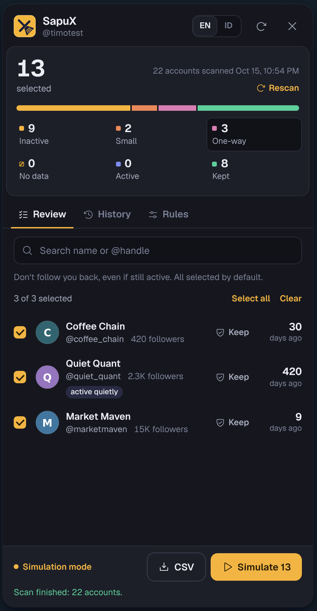

# SapuX


**Unfollow inactive X (Twitter) accounts safely, from your own browser.**

SapuX is a small Chrome extension that scans the accounts you follow, sorts them by when they last posted, and unfollows the ones you pick, slowly and with a daily limit. Everything runs locally. There is no server, no account to create, no API key and no dependencies.

[Bahasa Indonesia](README.id.md)

<p>
  
  
</p>

## Features

- **Inactivity filter.** Accounts with no posts, replies or reposts for N days (default 180) are pre-selected.
- **Small accounts.** Optionally sweep accounts under N followers (bots, airdrop farms) even if they still post.
- **One-way.** Optionally sweep accounts that don't follow you back.
- **Quiet activity detection.** If an account's following count changed between two scans, it is still opening X even without posting, so it counts as active.
- **Follow-back filter.** Chips under the search box (All · Follows you · Doesn't follow) narrow whichever group you're viewing, with live counts.
- **Protection.** Your keep list, mutuals and accounts above N followers are never touched. Add or remove anyone from the list with one click.
- **Queue that resumes.** When the daily limit is hit, you press Stop, or the tab closes, the remaining accounts are saved. Resume tomorrow from where you stopped.
- **Desktop notifications** when a live run finishes or stops.
- **Backup and restore** your rules and keep list as a JSON file.
- **History with undo.** Every unfollow is logged; follow anyone again with one click. CSV export for scans and history.
- **Simulation mode on by default**, plus a confirmation before every run.
- English and Bahasa Indonesia, light and dark theme (follows X).

## Install

SapuX is not on the Chrome Web Store, so you load it yourself:

1. Download this repository (Code → Download ZIP) and unzip it, or `git clone` it.
2. Open `chrome://extensions` and turn on **Developer mode** (top right).
3. Click **Load unpacked** and pick the folder that contains `manifest.json`.
4. Open https://x.com, log in and scroll the timeline for a few seconds so SapuX can pick up your session.
5. Click the yellow **SapuX** button at the bottom left of the page, or the extension icon in the toolbar.

Works in Chrome, Brave, Edge and other Chromium browsers.

## How to use

1. **Rules tab.** Set how many days without posts counts as inactive, and optionally: keep big accounts (followers ≥ N), sweep small accounts, sweep one-way accounts, and your keep list. Save.
2. **Review tab → Scan following.** SapuX loads everyone you follow (200 per request) and groups them:

   | Group | Meaning | Selected by default |
   |---|---|---|
   | Inactive | Last post is older than your limit | Yes |
   | Small | Fewer followers than your limit, even if active (when enabled) | Yes |
   | One-way | Doesn't follow you back, even if active (when enabled) | Yes |
   | No data | Never posted, or X returned no post | No, check them yourself |
   | Active | Still posting | Can't be selected |
   | Kept | Keep list, mutuals, or big accounts | Can't be selected |

3. Go through the list. Search by name or @handle, narrow it with the **Follows you / Doesn't follow** chips, click a row to tick or untick it, or click **Keep** to protect an account for good. Export a CSV if you want a record.
4. Click **Simulate**. It runs the whole flow without sending a single unfollow and writes the result to History.
5. When you're happy, turn off **Simulation mode** in Rules and click **Unfollow N**. Keep the X tab open; you can press **Stop** at any time.
6. Anything left over (daily limit, Stop, closed tab) shows up as a queue card with **Resume** and **Discard**.
7. Unfollowed someone by mistake? **History → Follow again**.

Rescan every few weeks. Quiet activity detection needs two scans to compare.

<p>
  
  
  
</p>

## Safety

| Risk | What SapuX does |
|---|---|
| Rate limits or suspension | Random 20 to 45 s pause between unfollows, a 3 to 6 min break every 10, and a daily limit of 80 by default (max 500). The pause can't go below 10 s. If you raise the limit, do it gradually. |
| X answers with a rate limit, 403, locked account or unknown error | Stops completely. No retries. |
| Unfollowing the wrong people | Simulation on by default, confirmation dialog, CSV export, keep list, Follow again. |
| Accounts with no data swept by accident | They sit in their own group and are not pre-selected. |
| Token theft | The session token stays in `chrome.storage.session` (memory only, gone when the browser closes). The `auth_token` cookie is never read. |
| Data leaving your machine | Requests go only to `x.com` and `api.x.com`. No analytics, no CDN; the font and icons are bundled. |
| Malicious names or bios | The panel lives in a closed Shadow DOM and renders text with `textContent`, never `innerHTML`. |
| Formula injection in CSV | Cells that start with `= + - @` are escaped. |
| Tampered backup file | Imported settings go through the same validator as the form, so every number is clamped to safe limits and unknown fields are dropped. |

### Permissions

- `storage`: rules, scan results, history, queue and the daily counter, on your computer.
- `webRequest`: read the `Authorization` header of X's own web requests.
- `notifications`: the desktop notification at the end of a live run (can be turned off in Rules).
- Host access: `x.com` and `api.x.com` only.

## Limitations

- SapuX uses X's internal web API (the same calls x.com makes), not the paid official API. If X changes it, scans can fail until SapuX is updated. Automation always carries some risk under X's rules, so keep the daily limit reasonable.
- "Active" is based on the latest post, reply or repost X returns. Likes don't count. X doesn't expose "last seen"; quiet activity detection is the closest signal.
- Chrome slows timers in background tabs. Runs stay safe, just slower.

## Project layout

```
manifest.json        MV3 manifest; name and description come from _locales
_locales/            extension name and description (en, id)
background.js        captures the Authorization header, shows notifications
lib/core.js          pure logic: classification, quiet activity, whitelist, CSV, settings
lib/i18n.js          every UI string (English default + Bahasa Indonesia)
lib/api.js           calls to X endpoints
lib/store.js         chrome.storage.local (settings, scan, history, queue, daily count)
lib/engine.js        scan + unfollow loop with pauses, daily limit and auto-stop
ui/icons.js          Phosphor icons (MIT)
ui/panel.js          the panel injected into x.com
icons/               logo (SVG + PNG 16/32/48/128)
fonts/               Geist (OFL)
tests/               Node tests, no dependencies
docs/screenshots/    images for this README
```

No build step and no `npm install`: the code you read is the code Chrome runs.

## Tests

```bash
node --test
```

28 tests cover classification (inactive, small, one-way, quiet activity, protection), scan merging, settings limits, CSV escaping, the unfollow engine (daily limit, stop on 429/403, skipping deleted accounts, Stop button, simulation sends nothing) and translation completeness. They run on every push through GitHub Actions.

## License

[MIT](LICENSE). Bundled third-party assets: Geist font under the SIL Open Font License (`fonts/OFL-Geist.txt`), Phosphor icons under MIT (`ui/LICENSE-phosphor.txt`).

SapuX is not affiliated with X Corp.
