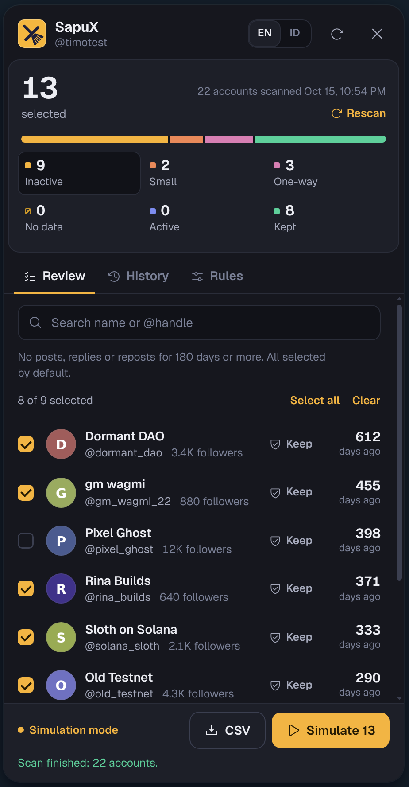
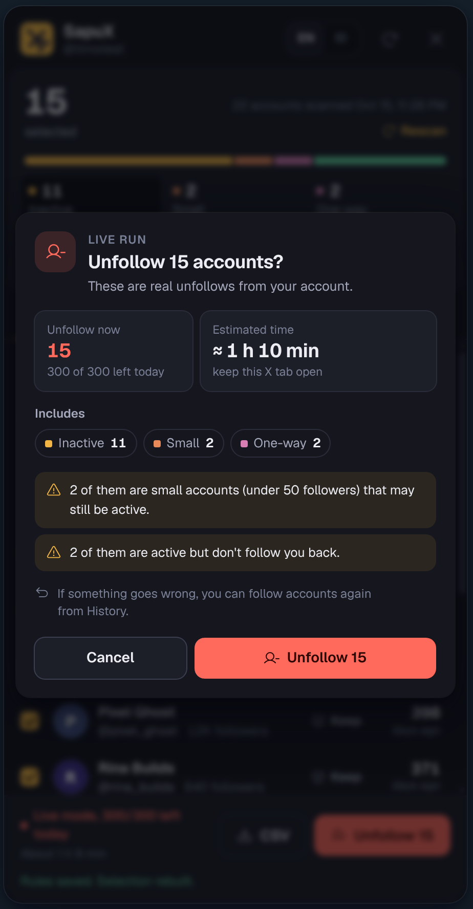
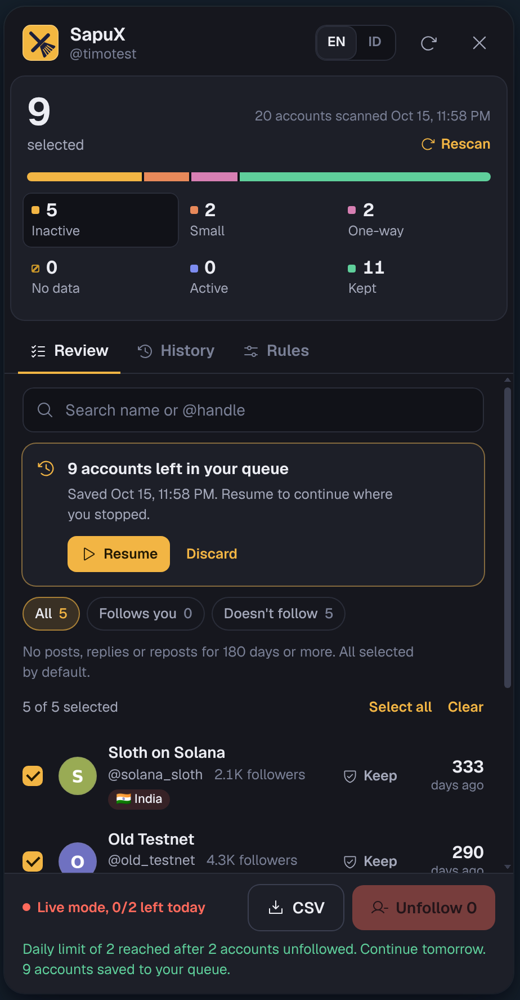
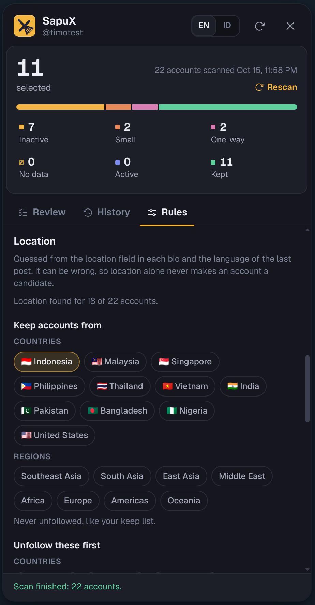
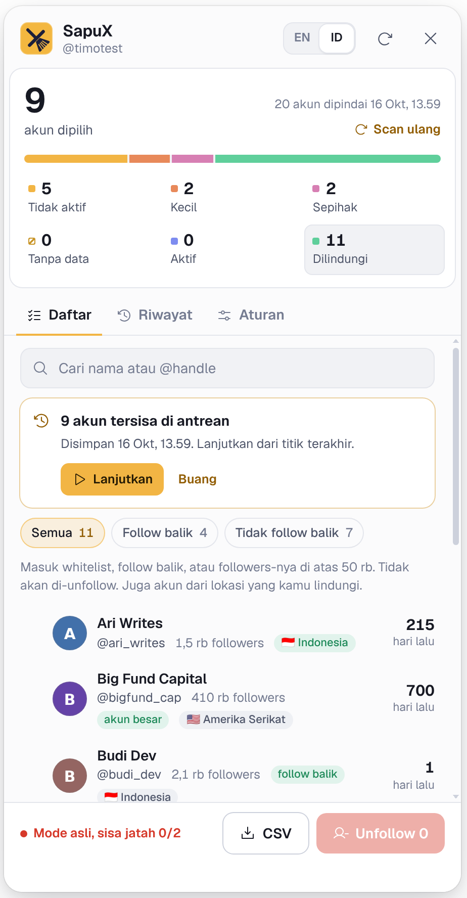

# SapuX


**Unfollow inactive X (Twitter) accounts safely, from your own browser.**

SapuX is a small Chrome extension that scans the accounts you follow, sorts them by when they last posted, and unfollows the ones you pick, slowly and with a limit per 24 hours. Everything runs locally. There is no server, no account to create, no API key and no dependencies.

[Bahasa Indonesia](README.id.md)

<p>
  
  
</p>

## Features

- **Inactivity filter.** Accounts with no posts, replies or reposts for N days (default 180) are pre-selected.
- **Small accounts.** Optionally sweep accounts under N followers (bots, airdrop farms) even if they still post.
- **One-way.** Optionally sweep accounts that don't follow you back.
- **Quiet activity detection.** If an account's following count changed between two scans, it is still opening X even without posting, so it counts as active.
- **Follow-back filter.** Chips under the search box (All · Follows you · Doesn't follow) narrow whichever group you're viewing, with live counts.
- **Location rules.** SapuX guesses where an account is based from flags, places and everyday words in its name, bio and location, plus the language of its last post, and rates each guess high, medium or low. Once some accounts are checked with X, it shows how often the guesses matched. Keep whole countries or regions (say Indonesia or Southeast Asia), and send others to the front of the queue (say India). You can also check candidates against X's official "Account based in" (one request per account, slow and rate-aware); that data replaces the guess, and accounts X flags as possibly on a VPN are never prioritized. By default only X's data can put an account at the front of the queue; guesses are used for protection. Location alone never makes an account a candidate.
- **Protection.** Your keep list, mutuals, places you keep and accounts above N followers are never touched. Add or remove anyone from the list with one click.
- **Rolling 24-hour limit.** Only unfollows from the last 24 hours count, not "today", so the limit can't double around midnight. When it is full, SapuX shows when the next slot opens.
- **Queue that resumes.** When the limit is hit, you press Stop, or the tab closes, the remaining accounts are saved. Resume from where you stopped once slots open.
- **Desktop notifications** when a live run finishes or stops.
- **Backup and restore** your rules and keep list as a JSON file.
- **History with undo.** Every unfollow is logged; follow anyone again with one click. CSV export for scans and history.
- **Simulation mode on by default**, plus a clear confirmation before every run: how many now, how many go to the queue, estimated time and warnings.
- **Pace presets.** Safe, Balanced or Fast fill in all pauses at once, with the time per 100 accounts shown on each.
- **Health check.** One click tests SapuX against X right now, read-only: login, session, following list, location check, daily limit and scan age, each with a fix when something is off.
- English and Bahasa Indonesia, light and dark theme (follows X).

## Install

> **Get SapuX only from this repository's [Releases](https://github.com/masterputra169/sapuX/releases).** It is free and has no paid version. Copies shared elsewhere may be modified to steal your X session. See [SECURITY.md](SECURITY.md) for how to verify a download.

1. Download `sapux-<version>.zip` from the latest [release](https://github.com/masterputra169/sapuX/releases) and unzip it.
2. Open `chrome://extensions` and turn on **Developer mode** (top right).
3. Click **Load unpacked** and pick the unzipped folder (the one that contains `manifest.json`).
4. Open https://x.com, log in and scroll the timeline for a few seconds so SapuX can pick up your session.
5. Click the yellow **SapuX** button at the bottom left of the page, or the extension icon in the toolbar.

Works in Chrome 116+, Brave, Edge and other Chromium browsers. To update, unzip the new release over the old folder and click **Reload** in `chrome://extensions`; your rules and history are kept.

## How to use

1. **Rules tab.** Set how many days without posts counts as inactive, and optionally: keep big accounts (followers ≥ N), sweep small accounts, sweep one-way accounts, and your keep list. Save.
2. **Review tab → Scan following.** SapuX loads everyone you follow (200 per request) and groups them:

   | Group | Meaning | Selected by default |
   |---|---|---|
   | Inactive | Last post is older than your limit | Yes |
   | Small | Fewer followers than your limit, even if active (when enabled) | Yes |
   | One-way | Doesn't follow you back, even if active (when enabled) | Yes |
   | No data | Never posted, or X returned no post | No, check them yourself |
   | Active | Still posting | Can't be selected |
   | Kept | Keep list, mutuals, or big accounts | Can't be selected |

3. Go through the list. Search by name or @handle, narrow it with the **Follows you / Doesn't follow** chips, click a row to tick or untick it, or click **Keep** to protect an account for good. Export a CSV if you want a record.
4. Click **Simulate**. It runs the whole flow without sending a single unfollow and writes the result to History.
5. When you're happy, turn off **Simulation mode** in Rules and click **Unfollow N**. Keep the X tab open; you can press **Stop** at any time.
6. Anything left over (daily limit, Stop, closed tab) shows up as a queue card with **Resume** and **Discard**.
7. Unfollowed someone by mistake? **History → Follow again**.

Rescan every few weeks. Quiet activity detection needs two scans to compare. If something stops working after X updates, open **Rules → Health check** and run it: it tells you which part broke and what to do.

<p>
  
  
  
</p>

## Safety

| Risk | What SapuX does |
|---|---|
| Rate limits or suspension | Random 20 to 45 s pause between unfollows, a 3 to 6 min break every 10, and a limit of 80 per rolling 24 hours by default (max 500). The pause can't go below 10 s. If you raise the limit, do it gradually. |
| X answers with a rate limit, 403, locked account or unknown error | Stops completely. No retries. |
| Unfollowing the wrong people | Simulation on by default, confirmation dialog, CSV export, keep list, Follow again. |
| Accounts with no data swept by accident | They sit in their own group and are not pre-selected. |
| Token theft | The session token stays in `chrome.storage.session` (memory only, gone when the browser closes). The `auth_token` cookie is never read. |
| Data leaving your machine | Requests go only to `x.com` and `api.x.com`. No analytics, no CDN; the font and icons are bundled. |
| Malicious names or bios | The panel lives in a closed Shadow DOM and renders text with `textContent`, never `innerHTML`. |
| Formula injection in CSV | Cells that start with `= + - @` are escaped. |
| Tampered backup file | Imported settings go through the same validator as the form, so every number is clamped to safe limits and unknown fields are dropped. |

### Permissions

- `storage`: rules, scan results, history, queue and the times of your last 24 hours of unfollows (for the limit), on your computer.
- `webRequest`: read the `Authorization` header of X's own web requests.
- `notifications`: the desktop notification at the end of a live run (can be turned off in Rules).
- Host access: `x.com` and `api.x.com` only.

## Limitations

- Location without the X check is a guess: the bio location is free text the owner writes, and post language is not the same as country (English tells nothing, so it is ignored). X's own "Account based in" is better but not perfect either (VPNs, accounts that show only a region), and checking it costs one request per account.
- SapuX uses X's internal web API (the same calls x.com makes), not the paid official API. If X changes it, scans can fail until SapuX is updated. Automation always carries some risk under X's rules, so keep the daily limit reasonable.
- "Active" is based on the latest post, reply or repost X returns. Likes don't count. X doesn't expose "last seen"; quiet activity detection is the closest signal.
- Chrome slows timers in background tabs. Runs stay safe, just slower.

## Project layout

```
manifest.json        MV3 manifest; name and description come from _locales
_locales/            extension name and description (en, id)
background.js        captures the Authorization header, shows notifications
lib/geo.js           location guess from bio text, flags and post language
lib/core.js          pure logic: classification, quiet activity, whitelist, CSV, settings
lib/i18n.js          every UI string (English default + Bahasa Indonesia)
lib/api.js           calls to X endpoints
lib/store.js         chrome.storage.local (settings, scan, history, queue, 24 h limit)
lib/engine.js        scan + unfollow loop with pauses, daily limit and auto-stop
ui/icons.js          Phosphor icons (MIT)
ui/styles.js         panel styles and logo
ui/base.js           shared constants, safe DOM helpers, state
ui/dialog.js         in-panel confirmation dialog
ui/shell.js          header, status, data loading, tabs, summary meter
ui/review.js         Review tab: list, search, filters, queue card, action bar
ui/actions.js        scan, unfollow, queue, notifications, CSV export
ui/history.js        History tab
ui/health.js         read-only health check against X
ui/rules.js          Rules tab: rules, location, pace, backup
ui/geo-ui.js         "Account based in" check for candidates
ui/panel.js          mounts the panel (loaded last)
icons/               logo (SVG + PNG 16/32/48/128)
fonts/               Geist (OFL)
tests/               Node unit tests, no dependencies
tests/e2e/           end-to-end tests: real Chromium + SapuX + a fake x.com
docs/screenshots/    images for this README
```

No build step and no `npm install`: the code you read is the code Chrome runs.

## Tests

```bash
node --test                 # 55 unit tests, no dependencies
bash tests/e2e/run_all.sh   # end-to-end, needs Python + Playwright + Chromium
```

The unit tests cover classification (inactive, small, one-way, quiet activity, protection, location), location guessing and its accuracy measure, the "Account based in" checker (rate-limit waits, stale request IDs), scan merging, the rolling 24-hour limit (midnight, migration from the old counter), settings limits, CSV escaping, the unfollow engine (daily limit, stop on 429/403, skipping deleted accounts, Stop button, simulation sends nothing) and translation completeness.

The end-to-end tests load SapuX into a real Chromium against a fake x.com served over HTTPS and click through everything a user does: scan, search, keep, simulate, live unfollow with the 24-hour limit and slots reopening, the resumable queue, notifications, backup/restore, both languages and themes, location rules, the X location check, the health check, and the "extension was updated" screen. Both suites run on every push through GitHub Actions.

## License

[MIT](LICENSE). Bundled third-party assets: Geist font under the SIL Open Font License (`fonts/OFL-Geist.txt`), Phosphor icons under MIT (`ui/LICENSE-phosphor.txt`).

## Disclaimer

SapuX is free, open-source software provided as is, without warranty (see [LICENSE](LICENSE)). Automating unfollows can go against X's rules, and X may limit, lock or suspend accounts it considers spammy. You are responsible for how you use it: start in simulation mode, keep the daily limit low, and stop if X warns you. SapuX is not affiliated with, endorsed by or sponsored by X Corp.

Privacy: [PRIVACY.md](PRIVACY.md) · Security reports: [SECURITY.md](SECURITY.md)
